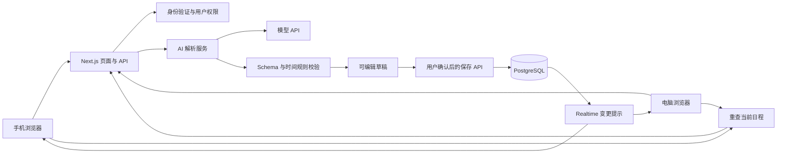

# 多端互通 AI 日程应用：可行性与技术方案

分析日期：2026-10-27  
需求依据：[《AI应用开发实习生（内容方向）- 笔试》](https://dtlrv460a0.feishu.cn/wiki/PHwaw0yzEiBnuOk9Xp1cQxzAnab)  
文档用途：选题决策、三天开发计划与后续产品路线。本文是实施建议，不代表应用已经开发或测试完成。

## 1. 结论：方向可行，首版必须围绕三天交付收敛

**建议做，但把第一版定义为“手机、电脑都能用的 AI 日程整理器”。** 先完成同一账号在两个浏览器上的真实数据同步，突出把一段杂乱想法变成可执行日程的过程。

原文是一项内容方向的开发笔试，重点是作品能运行、玩法有吸引力、普通人能看懂并愿意尝试。因此，完整的商业日历架构不是这次交付的主要目标。一个稳定、有清晰使用场景、能录出效果的视频作品，更符合题意。

| 判断维度 | 结论 | 前提或限制 |
| --- | --- | --- |
| 笔试选题匹配度 | 较高，属于 AI 实用工具方向 | 展示一个具体痛点，避免只介绍技术栈 |
| 三天做出可运行作品 | 可行 | 已有基础 Web 开发能力，能使用模型 API、数据库和部署服务 |
| 手机与电脑数据互通 | 可行 | 同一响应式网站、同一账号、同一云端数据库 |
| AI 理解自然语言日程 | 可行 | 结构化解析、程序校验、可编辑预览共同保证结果 |
| AI 自动安排复杂生活计划 | 第一版不承诺 | 先处理少量任务和明确约束，复杂情况让用户决定 |
| 全平台原生客户端与可靠后台提醒 | 三天内不宜承诺 | 涉及平台权限、系统调度、推送和真机测试 |
| 商业化前景 | 尚待验证 | 技术能实现不等于用户愿意长期使用或付费 |

本文按“单人、有 React/TypeScript 基础、三天约 24 小时有效投入”估算。若还需要从零学习前端、申请账号或处理部署，应继续削减功能。原文要求在收到作业后三天内提交；实际截止时间需按收件时间计算，本文不推定具体日期。

## 2. 原文要求与本项目交付对应关系

以下为原文要求的归纳；功能和技术选择是本文建议，不是出题方指定。

| 原文要求 | 本项目应该交付什么 |
| --- | --- |
| 利用 AI 做出有趣、可体验的小作品 | 能把日常表达转换成日程的可用应用 |
| 允许实用工具、自选题等方向 | 选择“安排面试、学习和生活事项”这一具体痛点 |
| 必交作品本体，项目仓库、在线 Demo、安装包任选 | 优先在线 Demo＋源码仓库；至少保证一种形式能运行 |
| 附简单运行说明 | README：环境、配置、启动、数据库初始化、示例与限制 |
| 图文或视频二选一，两者都有可加分 | 1000–2000 字图文教程，或 1–3 分钟有剪辑和字幕的视频 |
| 必交 300 字以内的创作说明 | 说明选题、看点、实际使用的 AI 工具、实际遇到的问题、拟发布标题与平台 |
| 三天内完成 | 最后一天为测试与内容制作保留至少半天 |

**技术方案不是最终提交物的替代品。** 后续还需要真正完成作品、README、展示内容和创作说明。

## 3. 产品定位与值得展示的场景

建议暂定名称：**顺手排**。一句话介绍：把脑子里的一堆安排说出来，AI 帮你整理，手机和电脑接着用。

第一版面向学生、求职者或个人效率用户，专注“事情记在脑子里，打开日历却懒得逐项填写”的问题。不要同时面向团队会议、企业审批和项目管理。

### 3.1 主演示场景（P0 保底）

用户输入：

> 明天下午三点到四点面试，今天晚上七点到八点改简历，八点到九点准备面试。

应用完成以下过程：

1. 从一段话里识别三项日程，区分今天与明天。
2. 将用户明确给出的时间转换成可编辑的日程卡片。
3. 展示具体日期、时间和时长，允许修改。
4. 用户确认后保存，电脑端出现同样的日程。
5. 在电脑端调整某项安排，手机端刷新为新结果。

若 P1 已完成，再增加排期演示：“今天晚上七点到九点有空，想用四十分钟改简历、四十五分钟准备面试。”应用依据给定窗口与已有日程提出时间建议；未实现 P1 时不演示或宣传这一能力。

这里的吸引力来自“杂乱表达变成清晰时间表”和“两台设备接力”的可见效果。可以用一句轻松的状态文案增加个性，但不必开发宠物、养成系统或复杂聊天人设。

### 3.2 与普通聊天窗口的差别

普通聊天只能给出一段建议；本应用把建议转换成可以编辑、保存、查询、完成和跨端继续使用的日程对象。AI 的输出必须进入真实业务闭环。

### 3.3 先验证需求，暂不假设商业成功

完成作品后，邀请 3–5 位目标用户用自己的低敏感示例试用：是否比手工录入省事、哪些时间表达容易出错、第二天是否还愿意回来使用。用观察结果决定优先补提醒、输入方式还是排期功能。

## 4. 三天版本的功能边界

| 优先级 | 功能 | 明确边界 |
| --- | --- | --- |
| P0 | 手机与电脑响应式界面 | 同一网站；手机优先列表/时间线，电脑可并列展示输入和日程 |
| P0 | 账号登录与个人数据隔离 | 两台设备登录同一账号；不能把公开共享账号当作个人同步 |
| P0 | 自然语言生成日程草稿 | 一次最多处理约 5 项；固定时间日程优先 |
| P0 | 草稿确认与手工修正 | 生成后不自动落库；可修改标题和时间，取消草稿无副作用 |
| P0 | 新建、查看、手工修改、删除、完成 | 单次个人日程；删除使用软删除，保留防重和版本信息 |
| P0 | 跨端同步 | 保存后刷新，页面回到前台和重连时补拉数据 |
| P0 | 明确的错误状态 | 解析失败、无网络、未保存、同步冲突不能显示成成功 |
| P1 | 简单空闲时段排期 | 仅针对用户给定窗口与时长；算法检查冲突，不能硬塞超时任务 |
| P1 | 前台站内提醒 | 页面活跃时提示；重新打开页面显示错过的事项 |
| P1 | PWA 安装、示例卡片、截图分享 | 主闭环完成后再选一项；截图使用虚构信息 |
| 后续 | 原生 App、桌面安装包、桌面组件 | 不计入三天首版 |
| 后续 | 离线修改与自动合并 | 首版只保留输入草稿，未联网保存不得显示“已同步” |
| 后续 | 循环、全天、跨时区复杂日程 | 模型先识别为暂不支持，不静默转换成单次日程 |
| 后续 | 飞书、Google、Outlook 双向同步 | 与自有应用跨设备同步分别规划 |
| 后续 | 语音、图片、聊天记录导入 | 会增加识别、权限与隐私处理工作，首版使用文本 |

**最低可交付闭环是：输入 → 草稿卡片 → 确认 → 持久化日程 → 另一端可见。** 简单排期如果来不及，可以只展示用户明确给定起止时间的多条日程，但宣传语也要相应改成“AI 日程整理”，不能声称已实现自动规划。

## 5. 技术栈选择

### 5.1 推荐组合

**Next.js＋TypeScript＋Tailwind CSS＋Supabase（PostgreSQL/Auth/Realtime）＋可输出 JSON 的模型 API。**

这是针对三天交付的工程选择，默认开发者熟悉 React。若已熟悉 Vue、Nuxt 或另一套成熟栈，保留现有能力更划算，不必为了这份方案迁移技术栈。

| 层 | 推荐 | 选择理由 |
| --- | --- | --- |
| 页面 | Next.js、React、TypeScript | 前后端放在同一项目，减少接口和部署衔接 |
| UI | Tailwind CSS＋少量现成组件 | 快速做好手机、电脑两种布局 |
| 日程展示 | 自制列表/时间线 | 首版不必引入完整月历、拖拽、资源排班组件 |
| 后端 | Next.js Route Handlers | 登录检查、AI 代理、结构校验、保存操作集中处理 |
| 数据 | Supabase PostgreSQL | 持久化事件、草稿提交结果与用户偏好 |
| 身份与隔离 | Supabase Auth＋RLS | 使用成熟认证，按所属用户限制记录访问 |
| 同步 | Realtime 提示＋重新查询 | 简化跨端更新；同时准备轮询降级 |
| AI | 例如 DeepSeek 的 JSON 输出接口 | 先验证实际账号可用模型，不绑定未经验证的型号 |
| 输入校验 | Zod 或同类 Schema 校验器 | 不信任模型结果，也不信任浏览器提交参数 |
| 部署 | 已熟悉且目标网络可访问的 Node.js 托管环境 | 选择以能稳定访问和复现为先 |

Supabase 提供 Next.js 接入、认证和数据库变更订阅文档；按用户限制数据需要正确配置数据库权限与 RLS。浏览器可使用公开项目密钥，但管理密钥必须留在服务端。[Next.js 接入](https://supabase.com/docs/guides/getting-started/quickstarts/nextjs)、[RLS 文档](https://supabase.com/docs/guides/database/postgres/row-level-security)、[Realtime 文档](https://supabase.com/docs/guides/realtime/postgres-changes)

### 5.2 部署与网络的前置验证

第一天最初两小时，先用手机蜂窝网络和电脑网络验证：站点打开、登录、数据库读写、模型调用。实际目标网络无法稳定访问时，立即换用已有可用基础设施，不要等第三天再处理。

Next.js 可以自托管；它不要求必须部署到某一家云平台。自托管需要处理 HTTPS、反向代理、进程运行与环境变量。若没有现成环境，三天内不建议再从零自建整套认证和数据库运维。[Next.js 自托管说明](https://nextjs.org/docs/app/guides/self-hosting)

若在线部署暂时受阻，原题也接受可运行仓库：保留完整本地启动步骤，并在同一局域网的手机、电脑上展示真实共享数据。需要在 README 如实说明访问条件；只有录屏、无法运行的壳页面不算完整交付。

### 5.3 为什么首版不选全端原生开发

| 路线 | 适合情况 | 本次建议 |
| --- | --- | --- |
| 响应式 Web，PWA 可选 | 快速分发、链接体验、手机电脑共用 | 首选 |
| Flutter | 后续确实需要多平台原生应用，团队愿意维护 Dart | 产品阶段评估 |
| React Native/Expo＋Web | 已有 React 积累，后续重点补移动端体验 | 自然的后续路线 |
| 多套原生开发 | 对系统深度集成和体验有明确要求且团队充足 | 不适合本次时间预算 |

Flutter 官方支持多个移动、Web、桌面平台，但具体通知和系统日历能力仍需平台适配。React Native 的 Windows/macOS 等由独立平台项目提供，也不能理解为一套手机 UI 自动覆盖桌面。[Flutter 平台支持](https://docs.flutter.dev/reference/supported-platforms)、[React Native 平台说明](https://reactnative.dev/docs/out-of-tree-platforms)

## 6. 系统架构与关键流程



图中 Realtime 只负责提醒客户端重新读取数据。应用是否保存成功，以服务端事务提交结果为准。

### 6.1 AI 解析与落库分成两个阶段

1. 前端提交文本、用户时区和本次请求标识。
2. 服务端验证登录状态，建立参考时间；读取排期需要的有限日期窗口。
3. 模型输出结构化草稿及待澄清项，不直接写数据库。
4. 程序检查字段、日期、时长和冲突，返回可编辑卡片。
5. 用户确认后，保存 API 重新验证权限和时间约束。
6. 在数据库事务中防重、检查版本并写入；返回真实保存结果。
7. 两端读取同一份数据库记录，更新界面。

AI 解析超时或输出非法时，保留输入并允许手工录入。不要用伪造的成功结果掩盖失败。

需要原子性的多步骤写入，通过单个 PostgreSQL 函数/RPC 或数据库连接上的单个事务完成；连续发出多个 `supabase-js` 请求不等于一个事务。所有事件写入统一经过受控入口，按最小权限限制直接表写入绕过防重、版本或排期校验。若使用提升权限的数据库函数，必须显式校验调用者身份与记录归属，并固定安全的对象查找路径。

### 6.2 最少需要的接口

| 接口示意 | 用途 | 必须检查 |
| --- | --- | --- |
| `POST /api/ai/parse` | 文本变为草稿 | 身份、文本长度、调用配额、结果 Schema、超时 |
| `GET /api/events?from=...&to=...` | 查询指定窗口日程 | 用户归属、日期范围上限、禁用公共缓存 |
| `POST /api/events/commit` | 确认一批草稿 | 幂等键、字段与时间、事务内重新检查冲突 |
| `PATCH /api/events/:id` | 修改或标记完成 | 用户归属、`base_version` |
| `DELETE /api/events/:id` | 软删除 | 用户归属、版本、幂等语义 |

账号管理使用认证服务提供的机制。AI 密钥放在服务端；不要放入 `NEXT_PUBLIC_` 变量，也不要让模型自由生成数据库 SQL。涉及个人数据的 API 返回不能被不同用户共享缓存。

## 7. AI 方案：让模型理解，让程序判断

### 7.1 模型适合做什么

模型负责识别意图、标题、时间表达、时长、固定/可移动属性，以及缺失的信息。程序负责日期换算、字段约束、权限、冲突检查和持久化。

不需要先引入多 Agent、向量数据库、RAG 或复杂 Agent 框架。第一版只需一次受约束的解析请求，加确定性的校验和排期逻辑。

DeepSeek 官方提供 JSON 输出方式，同时提示可能出现空内容，并需要控制输出长度。因此“合法 JSON”与“正确日程”必须分别检查。即使采用支持 JSON Schema 的其他接口，也不能省略业务校验。[DeepSeek JSON 输出说明](https://api-docs.deepseek.com/guides/json_mode/)

### 7.2 结构化结果示例

下例假设参考时间为 2026-10-27，时区为 `Asia/Shanghai`；它是设计示例，不是真实创建记录。

```json
{
  "intent": "create_events",
  "needs_clarification": false,
  "questions": [],
  "events": [
    {
      "title": "面试",
      "start_local": "2026-10-28T15:00:00",
      "end_local": "2026-10-28T16:00:00",
      "timezone": "Asia/Shanghai",
      "time_source": "explicit",
      "assumptions": []
    }
  ]
}
```

服务端将本地时间与时区转换成实际时间点再保存。`time_source` 区分用户明确指定、程序建议和默认假设，界面应让用户看得到差异。不要依赖模型自报的置信度决定是否保存。

### 7.3 时间解析规则

- 每次请求传入固定的参考时间和用户时区，便于复现“明天”“下周三”的解析结果。
- 日期以用户时区计算；首版默认并明确显示上海时区，可暂不开放跨时区排期。
- “周五三点”没有说明上午下午时，应询问或让用户补选，不能悄悄猜测。
- “下周找时间健身”缺少时段与时长时，先询问；用户给出空闲窗口后才排期。
- 只有开始时间时，要求补结束时间，或显示明显标注的默认时长供用户确认。
- 对已经过去的时间给出提示；不要静默改到下一天。
- 遇到“每周一”“全天”等首版未支持的语义，明确说明限制，不能丢掉限定词后直接保存。
- 生成草稿后若跨过午夜或用户修改了安排，确认时再次显示具体日期并校验。

### 7.4 简单排期算法（P1）

先把固定日程作为不可移动区间。对用户给出的空闲窗口，扣除固定日程后得到可用区间，再按用户指定顺序或优先级放入有明确时长的任务。相邻日程采用半开区间 `[start, end)`，前一项结束时可以开始后一项。

冲突判断可以写成：`a.start < b.end && b.start < a.end`。算法负责校验具体时刻，模型可以解释结果，但不能越过约束强行安排。

例如，19:00–21:00 原本有 120 分钟，其中 20:00–20:30 已被占用，只剩 90 分钟；新任务总计 105 分钟时，返回“至少有 15 分钟无法安排”并让用户缩短、延期或扩大窗口。不要输出表面完整、实际重叠的计划。

对不可拆分任务，还要检查连续可用时长：空闲分钟总数足够，也不一定容得下一个较长任务。首版默认任务不可拆分，无法容纳则列出未安排项。

## 8. 数据模型与跨端一致性

### 8.1 建议的最小模型

| 表 | 主要字段 | 作用 |
| --- | --- | --- |
| `profiles` | `user_id`、`timezone` | 用户偏好；也可存入认证服务适合的用户配置位置 |
| `events` | `id`、`user_id`、`title`、`start_at`、`end_at`、`timezone`、`status`、`version`、`deleted_at`、创建/更新时间 | 正式日程 |
| `mutation_requests` | `user_id`、`request_id`、`payload_hash`、`result`、创建时间 | 防止重复保存；同一键但不同内容应拒绝 |

`start_at/end_at` 使用 PostgreSQL 的 `timestamptz` 表达实际时间点，另存 IANA 时区以保留展示与语义信息。约束包括：结束晚于开始、标题长度有上限、版本递增，以及 `(user_id, request_id)` 唯一。

草稿在确认前可以只保存在当前页面；正式记录才要求跨端同步。完整聊天历史、向量库、附件系统不进入首版。

### 8.2 三天同步实现

1. 两端登录同一账号，从数据库读取当前窗口的日程。
2. 保存成功后，当前端重新读取；另一端收到 Realtime 提示后重新读取。
3. 页面获得焦点、恢复联网、订阅恢复后，主动重新读取以补足遗漏。
4. 提供手动刷新和最后同步时间；实时订阅不稳定时，在前台改为约 5–10 秒轮询。
5. 使用请求序号或取消机制，避免较早发出的慢查询覆盖较新的结果。
6. 请求尚未发出时断网，保留输入并显示“未保存”；请求发出后超时或响应丢失，显示“保存状态待确认”，沿原 `request_id` 查询或重试以确认结果。服务端可能已经提交，不能一律断言未保存，更不能仅更新本地界面就显示“同步成功”。

数据量很小时，重新查询限定窗口比设计一整套增量协议更省事。分页、查询范围和返回条数仍需有上限。软删除后的数据不再出现在正常列表中。

### 8.3 两项不能省略的写入保护

**幂等保存：** 点击确认时生成 `request_id`，同一次操作的重试继续使用该标识；请求记录与日程写入必须在同一事务内完成。重复请求返回原结果，避免连点或超时重试造成多份日程。

**版本校验：** 每次修改/删除提交 `base_version`。服务端按用户、ID、版本共同匹配并递增版本；不匹配时返回冲突，让用户刷新后选择，不静默覆盖另一端的修改。

如果启用“排期不重叠”的承诺，保存时不能只检查草稿生成时的旧数据。需要在数据库事务中对同一用户的排期写入串行校验，例如使用用户级事务锁，并让所有相关写入遵守同一机制。单条事件的版本号不能发现另一端刚新增的事件。来不及完成这一层时，将冲突提示明确定位为建议，禁止宣传“绝不会冲突”。

### 8.4 数据隔离

读取、插入、修改和删除分别限制为当前认证用户的记录。服务端从可信会话推导 `user_id`，不接受浏览器或模型指定的所有者身份。Realtime 过滤条件用于缩小范围，不能代替权限控制。

优先以当前用户身份访问数据库并启用 RLS；若后台使用具有绕过 RLS 权限的管理密钥，则必须在服务端自行严格校验用户权限。用两个不同账号验证隔离，而不只是检查页面有没有隐藏按钮。[Supabase RLS 说明](https://supabase.com/docs/guides/database/postgres/row-level-security)

## 9. 提醒能力：首版与正式产品分开设计

### 9.1 首版承诺

三天版只提供可选的前台站内提示，并在重新进入页面时检查错过的事项。即使页面已打开，切到后台或锁屏也可能影响调度，因此不承诺系统级准点提醒。

PWA 安装入口不等于可靠后台提醒。iOS/iPadOS 的 Web Push 从 16.4 开始支持加入主屏幕的 Web App，还需要相应授权和服务端推送链路。该能力不必成为本次交付的关键路径。[WebKit 官方说明](https://webkit.org/blog/13878/web-push-for-web-apps-on-ios-and-ipados/)

### 9.2 正式产品提醒方案

服务端保存提醒任务与状态，原生客户端同步后向系统注册本地通知；必要时再结合远程推送。用户修改或删除日程后，要撤销旧通知并重新安排。

- iOS 可以向系统注册本地通知；后台静默推送不能当作保证执行的定时任务。[本地通知](https://developer.apple.com/documentation/usernotifications/scheduling-a-notification-locally-from-your-app)、[后台推送限制](https://developer.apple.com/documentation/usernotifications/pushing-background-updates-to-your-app)
- Android 精准提醒涉及权限和系统调度限制，要测试拒绝权限、重启、节电和取消操作。[Android 闹钟文档](https://developer.android.com/develop/background-work/services/alarms)
- 面向中国境内 Android 用户，应按目标机型验证推送渠道，不能默认单一 FCM 覆盖全部设备；Firebase 官方说明 Cloud Messaging 依赖 Google Play services。[Firebase 依赖说明](https://firebase.google.com/docs/android/android-play-services)
- 服务端推送请求成功不等于用户已看到通知；指标应区分已调度、已提交推送服务、设备回执和用户打开。
- 设备离线时，另一端取消的日程可能仍触发旧的本地提醒，必须在下次同步时撤销；无法承诺即时取消所有离线设备上的提醒。

后端可采用持久化任务表、到期扫描/队列、失败重试与去重。不能把长时间 `setTimeout` 放在短生命周期函数中充当提醒服务。多设备同时提醒还是只提醒选定设备，应作为明确的用户策略。

## 10. 外部日历互通与长期同步路线

**自有应用跨设备同步，与接入飞书/Google/Outlook，是两项不同的能力。** 首版完成前者即可，后者应在演示与 README 中标为未支持。

| 接入层次 | 建议顺序 | 工程边界 |
| --- | --- | --- |
| ICS 文件导出 | 可作为后续低成本扩展 | 是文件交换，不等于持续同步；重复导入可能产生重复项 |
| 单个平台只读接入 | 第一步 | 授权、字段映射、增量读取、删除处理、断连恢复 |
| 经用户确认的单向写入 | 第二步 | 幂等、权限、参会邀请副作用与失败重试 |
| 双向同步 | 最后考虑 | 双边编辑冲突、回环写入、循环例外、连接撤销与对账 |

Google Calendar 支持增量同步令牌；令牌失效需要重建同步状态，推送也需要结合补拉。Microsoft Graph 的 `calendarView/delta` 按指定时间窗口跟踪变化，应保存服务端返回的完整续传链接。飞书提供日程列表接口及其同步参数，接入时需要遵守日历类型、身份和权限限制，不能当成万能日历代理。[Google 增量同步](https://developers.google.com/workspace/calendar/api/guides/sync)、[Google 推送](https://developers.google.com/workspace/calendar/api/guides/push)、[Microsoft 日历增量](https://learn.microsoft.com/en-us/graph/delta-query-events?tabs=http)、[飞书日程接口](https://open.feishu.cn/document/server-docs/calendar-v4/calendar-event/list)

正式接入需要记录提供方、连接、日历、外部事件 ID、版本和同步游标。不能只依据标题相同来判定两条事件是同一项，也不能把一次事件更新反复同步回源系统。

长期离线编辑再引入本地数据库、待提交操作队列、服务端变更日志、增量游标和删除墓碑。事件修改与变更日志需在同一事务提交；不能只依靠设备时间或 `updated_at` 判断谁覆盖谁。游标过期重建本地镜像时，仍要保留并协调未提交操作。

循环日程还需要系列、单次例外和修改范围。每周当地时间上午九点不能简单按 UTC 加七天处理；全天事件应使用日期语义。具体格式参考 iCalendar，首版先排除这些情况。[RFC 5545](https://www.rfc-editor.org/info/rfc5545/)、[Google 循环日程](https://developers.google.com/workspace/calendar/api/guides/recurringevents)

## 11. 三天开发计划与止损点

以下为计划估算，不是已经完成的进度。建议按总计约 24 小时有效工作安排，并保留删功能的余地。

| 时间 | 工作 | 当天验收 |
| --- | --- | --- |
| 第一天前 2 小时 | 验证模型、数据库、登录、部署及手机网络 | 最小页面能在目标设备打开，服务链路真实可用 |
| 第一天剩余约 6 小时 | 登录、数据表、RLS、手工日程 CRUD、响应式布局 | 手机创建记录，电脑读到；重开页面数据仍存在 |
| 第二天约 8 小时 | AI 解析、预览卡片、时间校验、幂等与版本检查、同步刷新 | 一段文本生成真实日程；错误与重复提交有正确反馈 |
| 第三天前约 3 小时 | 修复关键问题、手机实测、部署复验，择优补一个 P1 | 主演示连续运行三次，不依赖临时手改数据库 |
| 第三天后约 5 小时 | README、截图/录屏、教程或视频、创作说明、提交检查 | 从干净环境可启动，展示素材齐全 |

止损规则：

1. 第一天网络或部署尚未稳定，优先确保可运行仓库与局域网演示，不增加新平台。
2. 第二天中午自然语言保存还没跑通，暂停自动排期、提醒和 PWA。
3. 第二天结束后冻结核心范围，优先处理错误和制作展示内容。
4. Realtime 调试超过约一小时还不稳定，使用前台轮询与聚焦刷新，保留真实同步效果。
5. 没有基础开发经验时，先做明确时间的单次日程；不把完整架构图里的每个后续能力都实现一遍。

后续工期仅作规划量级：稳定 Web 试用版通常还需数周迭代；原生客户端、后台提醒、离线编辑和外部日历双向同步应拆成独立阶段，不能统一承诺在几天内完成。具体排期取决于已有代码、平台数量与质量目标。

## 12. 验收标准与风险控制

### 12.1 必须通过的演示用例

| 场景 | 预期结果 |
| --- | --- |
| 手机输入明确日期和时间，确认后电脑打开 | 两端显示同一条真实日程 |
| 电脑修改，手机恢复前台 | 自动读取新内容，显示最新同步状态 |
| 保存按钮连点或同一请求重试 | 不重复创建 |
| 两端同时修改同一事件 | 旧版本被拒绝，给出刷新和重新确认入口 |
| 手机断网后保存 | 未发出的请求提示未保存；已发出但无响应的请求显示状态待确认，以原幂等键核实，不重复新建 |
| AI 超时、返回空内容或非法字段 | 无错误记录落库，可重试或手工填写 |
| “周五三点”缺少上午下午 | 追问或待补全，不擅自保存 |
| 切换另一账号 | 看不到前一个账号的数据；接口访问也被限制 |
| 删除后另一端刷新 | 事件消失，不被旧结果重新带回 |
| 任务超过空闲时间（若实现排期） | 明确列出无法安排项，不重叠硬塞 |

### 12.2 质量目标

以下是拟定验收目标，不是实测结论：

- 用约 20 条中文输入覆盖明确时间、相对日期、缺字段、多个事项和不支持语义，保存实际结果。
- 非歧义样例目标达到至少 90% 的关键字段正确率；歧义样例应正确要求补充信息，不把猜对当作成功。
- 正常网络下，以两台真实设备测量保存到可见的耗时；实时模式争取数秒内，轮询模式按设定间隔说明。
- 手机约 360 像素宽度下，输入、确认按钮和时间字段可正常操作。
- 三次连续录制主演示流程均能完成；截图必须来自真实运行状态。

### 12.3 最值得投入测试的地方

优先测试跨端版本冲突、防重复保存、用户隔离、时间转换和 AI 异常输出。界面样式调整以人工检查为主，不为了笔试再搭一套庞大测试平台。

隐私处理保持简单且明确：使用虚构演示日程；仅向模型发送当前任务必需的文本和忙闲区间；默认不记录完整日程原文到日志；登录令牌、模型密钥和管理密钥不进入仓库。需要对外分享时优先截图，不直接公开个人日历链接。

## 13. 成本估算方法

三天作品的主要成本是时间。模型、托管和数据库成本应按实际账号价格计算，不能默认免费套餐无限可用。本文不提供未经核实的服务商报价。

模型预算可使用：

```text
总模型费用 ≈ 输入 token 总量 / 1,000,000 × 输入单价
           + 输出 token 总量 / 1,000,000 × 输出单价
```

例如，调试与演示共 300 次解析，假设每次输入 1500 token、输出 500 token，则约为 45 万输入 token 和 15 万输出 token；将实际单价代入即可。该数字只是估算场景，重试、长上下文和推理计费可能增加用量。

开发时设置单次输入长度、输出上限、每日调用配额与总预算告警。AI 调用失败最多做有限重试；不要为每次页面刷新重新请求模型。数据库、带宽、日志和托管费用另计，首版无需 GPU 自部署模型。

## 14. 展示内容与提交包装

### 14.1 标题与开头

可选标题：

- 《不想一条条填日历，我做了个能听懂人话的日程助手》
- 《手机记一句，电脑接着用：我用 AI 做了个日程整理器》
- 《一堆碎碎念，变成今天的时间表：这个 AI 小工具真能用》

先展示输入前后的变化，再解释做法。若实际只支持文字输入，视频和标题不要暗示已经接入语音识别。

### 14.2 约两分钟视频结构

| 时间 | 画面和内容 |
| --- | --- |
| 0–10 秒 | 展示一段杂乱安排，提出日常痛点 |
| 10–35 秒 | 输入文本，出现可编辑日程卡片 |
| 35–65 秒 | 确认保存；手机与电脑同屏展示同步 |
| 65–85 秒 | 展示一次歧义追问或冲突提示，说明没有盲目照搬模型输出 |
| 85–105 秒 | 用简单语言解释：AI 整理、数据库保存、两端读取 |
| 105–120 秒 | 展示运行入口、适用人群和当前限制 |

保留真实等待和错误处理证据。可以剪掉无意义等待，但不要用硬编码结果冒充实时 AI，也不要把静态页面说成已经接入云同步。

### 14.3 1000–2000 字图文结构

建议依次写：日常痛点与结果截图、作品能做什么、准备账号与环境、启动步骤、输入并确认日程、两端同步体验、一个真实踩坑及修复、已知限制与复现入口。普通人不需要先理解数据库事务，但要能知道每一步操作的目的。

教程可以介绍 AI 编程如何帮助实现功能，具体工具名称和使用过程按实际记录填写，不预先编造开发经历。

### 14.4 最终提交清单

- 可运行源码仓库或在线 Demo；若交安装包则另附安装方式。
- README：所需运行时、安装与启动命令、环境变量示例、数据库建表/权限脚本、示例输入、功能边界。
- `.env.example` 中只放变量名称和占位值，不包含有效密钥。
- 至少一个新用户能按 README 跑通的验证记录。
- 1000–2000 字图文，或 1–3 分钟带字幕与剪辑的视频。
- 300 字以内创作说明，写实际选题理由、AI 工具、踩坑和拟发布平台。
- 明确区分已实现功能、演示环境条件和后续计划。

## 15. 最终建议

选择这个题目，先把“自然语言整理＋确认保存＋手机电脑同步”做到稳定。第二天主闭环已经完成，再增加简单排期或前台提醒中的一项。将完整原生多端、后台提醒、离线同步和外部日历接入放进路线图。

这份笔试最有说服力的证据，是别人能打开作品、亲自输入一句话、在另一台设备上看到真实结果，并且看完展示内容后知道它为什么有用、怎么复现。
