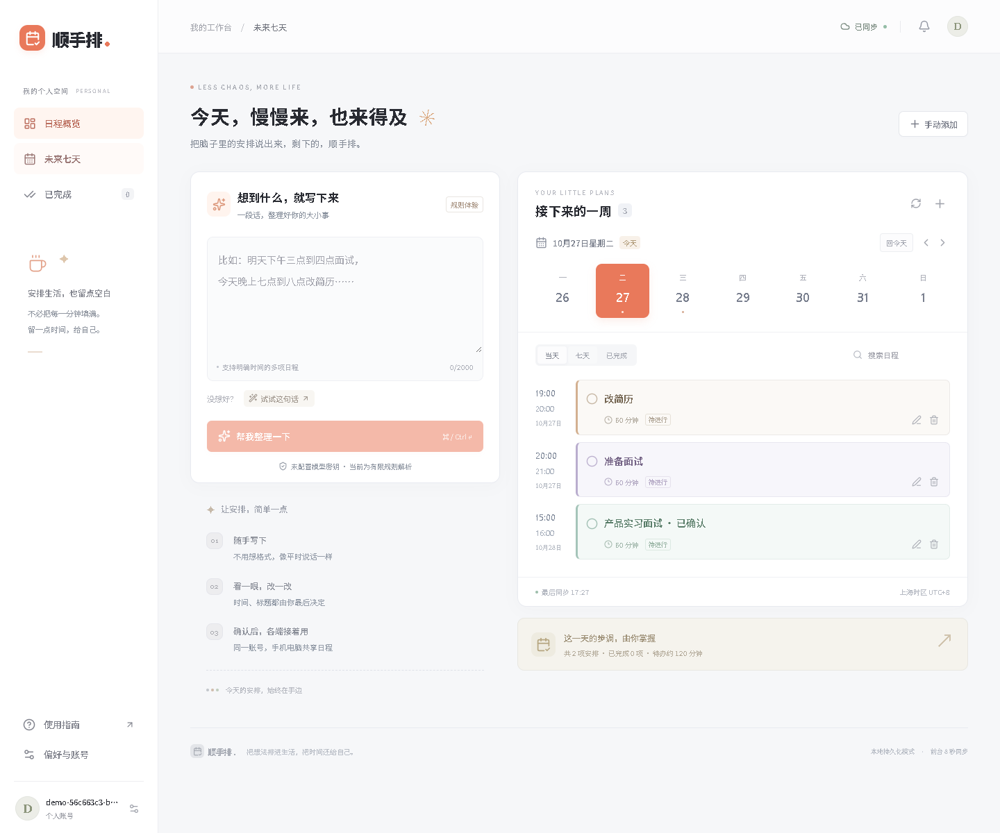

# 顺手排 · 把想法排进生活

把一段安排整理成可编辑草稿，确认后保存，再用手机、电脑接着安排。

[源码仓库](https://github.com/G-E-E-D/shunshoupai) · [图文教程](docs/tutorial.md) · [云端配置](docs/cloud-setup.md) · [验收记录](docs/acceptance.md) · [创作说明](docs/creation-note.md)



## 五分钟运行

需要 **Node.js 24+** 和 npm。默认模式不需要数据库服务或模型密钥。

```sh
git clone https://github.com/G-E-E-D/shunshoupai.git
cd shunshoupai
npm ci
npm run dev
```

打开 [http://localhost:3000](http://localhost:3000)，点击登录入口，选择“注册账号”，用自己的邮箱标识和至少 8 位密码注册。**没有预设共享账号**。本地模式不会发送验证邮件，暂未提供密码找回。

第一次写入会自动创建 `data/shunshoupai.sqlite`。关闭、重启服务后数据仍在。测试使用独立的临时数据库，不覆盖你的日程。

输入这句话，点击“帮我整理一下”，检查卡片后“确认保存”：

> 明天下午三点到四点面试，今天晚上七点到八点改简历，八点到九点准备面试。

**没有模型密钥时，页面会显示“规则体验 / 规则解析”。** 它是真正运行的有限中文规则解析器，不是模型调用。配置服务端 `AI_API_KEY` 后才会使用真实模型；上游错误不会伪装成成功。AI 与规则输出都必须经过校验和你的确认，不能直接写入数据库。

## 手机和电脑同步

1. 让两台设备连接同一局域网；停止开发服务，执行 `npm run build`、`npm run start`，使用生产服务演示。
2. 用 `ipconfig` 找到电脑的局域网 IPv4 地址，例如 `192.168.1.20`。
3. 两端打开 `http://192.168.1.20:3000`，登录同一账号。在 Windows 防火墙中仅对可信局域网允许该开发服务。
4. 手机保存，电脑查看；电脑修改后，让手机回到页面或点击刷新。

开发和生产命令均监听 `0.0.0.0`。开发配置已允许本机发现的 IPv4 地址用于调试；局域网体验仍推荐上述生产命令，以免依赖开发热更新的来源配置，服务电脑保持开机。HTTP 局域网演示请保持 `COOKIE_SECURE=false`，并留空 `APP_ORIGIN`，这样不同访问地址会按各自 Host 验证来源。若固定为 `http://localhost:3000`，手机地址的写请求会被拒绝；公网部署则应填写实际 HTTPS origin。

同步来源是同一服务端数据库。前台约 **8 秒**补拉一次，也会在聚焦、重连、手动刷新时查询；页面显示最后同步时间和错误状态。不是操作后只更新当前浏览器的模拟同步。两台设备各自运行一份本地服务不会共享数据；公网访问或多实例部署请使用 [Supabase 模式](docs/cloud-setup.md)。

## 已实现与边界

| 能力 | 当前行为 |
| --- | --- |
| 个人账号 | 本地密码哈希与可撤销会话，或 Supabase 邮箱认证；按用户隔离 |
| 一句话整理 | 最多 2000 字、每次 1–5 项；模型或明确标记的有限规则解析 |
| 草稿确认 | 修改标题和起止时间、移除或取消；确认前不入库 |
| 日程管理 | 新建、查看、修改、完成/恢复、软删除；当天/七天视图和已加载范围内搜索 |
| 保存保护 | 批量原子写入、请求幂等、版本冲突；事务内再次检查未完成日程重叠 |
| 错误处理 | 断网未发送显示未保存；响应丢失显示状态待确认，用原请求编号核实 |
| 前台提醒 | 可选；开始前 5 分钟和进行中显示站内提示 |
| 响应式界面 | 桌面双栏，手机单栏；截图见 [桌面](docs/screenshots/desktop.png) / [手机](docs/screenshots/mobile.png) |

时间统一使用上海时区，接受 2000–2100 年、最长 24 小时的单次日程。缺少结束时间时，会明确标注默认 60 分钟等假设，仍由用户确认。“周五三点”缺少上午/下午会追问；循环、全天和跨时区表达不会被悄悄转换为单次日程。

当前**未实现**自动寻找空档排期、后台/锁屏系统提醒、离线编辑合并、原生客户端、外部日历双向同步。草稿保留在当前浏览器，不承诺跨端共享。当前交付为可运行仓库和图文教程；真实模型、托管 Supabase、公网部署和真实手机网络测试需要相应账号配置，详见验收记录。

## 配置与部署

将 `.env.example` 复制为 `.env.local` 后按需填写，**不要提交密钥或本地数据**。

| 变量 | 说明 |
| --- | --- |
| `APP_STORAGE` | 默认 `local`；云端设为 `supabase` |
| `APP_DB_PATH` | 可选，SQLite 持久文件绝对路径；默认 `data/shunshoupai.sqlite` |
| `AI_API_KEY` | 模型密钥，仅服务端使用；留空使用规则解析 |
| `AI_BASE_URL` / `AI_MODEL` | OpenAI 兼容 Chat Completions 服务地址/可用模型 |
| `AI_DAILY_LIMIT` | 每账号每天解析上限，默认 50，限制为 1–100，UTC 零点重置 |
| `NEXT_PUBLIC_SUPABASE_URL` / `NEXT_PUBLIC_SUPABASE_ANON_KEY` | 云端项目地址和公开项目密钥，不使用管理密钥 |
| `APP_ORIGIN` / `COOKIE_SECURE` | 正式 HTTPS origin / 正式环境设为 `true` |

云端先执行 [SQL 迁移](supabase/migrations/20261027000000_initial.sql)，再填写 Supabase 配置。完整步骤、认证设置、权限与 RPC 说明见 [云端配置](docs/cloud-setup.md)。

```sh
npm run build
npm run start
```

SQLite 部署需要单个服务实例和持久可写磁盘；临时磁盘或多实例平台应使用 Supabase。仓库没有已发布的公网 Demo，不把本机地址当作在线部署地址。

## 检查与复现

```sh
npm run check
npx playwright install chromium
npm run test:e2e
```

`check` 依次运行 ESLint、TypeScript、单元/服务测试和生产构建。端到端测试覆盖浏览器业务流程，使用隔离的数据库。SQL 权限与事务检查脚本在 [supabase/tests/invariants.sql](supabase/tests/invariants.sql)，仅对可丢弃开发库执行。

测试不调用付费模型、不依赖外部数据库。自动化证据和仍需人工验证的部分详见 [验收记录](docs/acceptance.md)。

## 结构与提交材料

```text
src/app/                 响应式界面和 Route Handler API
src/lib/parser.ts        规则解析、真实模型适配和结构校验
src/lib/server/          账号、SQLite/Supabase、事务与请求保护
supabase/                云端迁移及 SQL 不变量测试
tests/                   解析/存储/接口与浏览器测试
docs/                    教程、截图、创作说明、展示脚本与验收记录
```

技术栈：Next.js、React、TypeScript、Zod、SQLite；可选 Supabase 和 OpenAI 兼容模型接口。界面使用自定义 CSS。

按原始方案选择图文作为展示材料：[1000–2000 字教程](docs/tutorial.md)、[300 字以内创作说明](docs/creation-note.md)、[待录制演示脚本](docs/demo-script.md)。需求与后续路线保留在 [原始技术方案](AI日程应用可行性与技术方案.md)；其中未来规划不代表当前已实现功能。
