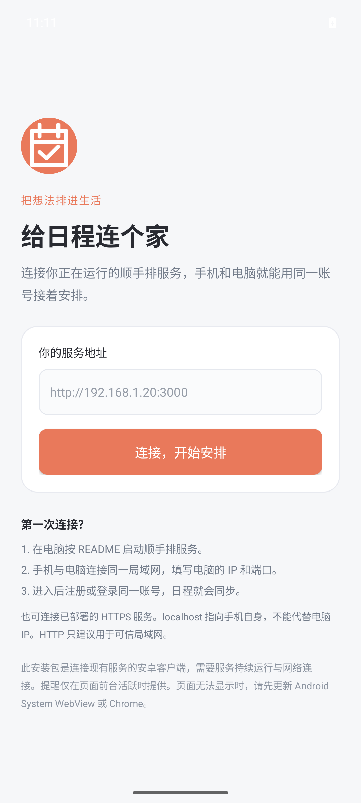

# Android 客户端

顺手排提供可安装的 Android 客户端，支持 Android 8.0（API 26）及以上版本。客户端使用系统 WebView 连接你自己的顺手排服务，提供独立应用入口、服务地址设置、返回、刷新和连接失败重试。

**APK 不包含数据库服务或模型密钥。** 首次安装需要填写可访问的顺手排服务地址；同一服务、同一账号才会与电脑端共享日程。当前仓库没有默认公开后端，不会把手机上的 `localhost` 当作电脑地址。

## 下载与安装

1. 打开 [v1.1.0 发布页](https://github.com/G-E-E-D/shunshoupai/releases/tag/v1.1.0)，下载 **[shunshoupai-android-v1.1.0.apk](https://github.com/G-E-E-D/shunshoupai/releases/download/v1.1.0/shunshoupai-android-v1.1.0.apk)**。
2. 同一版本提供 [SHA256SUMS.txt](https://github.com/G-E-E-D/shunshoupai/releases/download/v1.1.0/SHA256SUMS.txt) 和 [signing-cert.txt](https://github.com/G-E-E-D/shunshoupai/releases/download/v1.1.0/signing-cert.txt)，可核对下载文件的校验值和签名信息。
3. 在 Android 的文件管理器中打开 APK，按系统提示允许该文件管理器安装此来源的应用，再完成安装。
4. 打开“顺手排”，输入服务地址，点击连接。进入工作台后注册或登录自己的账号。

更新时安装同一项目后续发布的 APK，可保留应用配置。安装包的应用 ID、签名密钥必须保持一致，`versionCode` 必须递增。自行构建的调试包使用不同签名，不能直接覆盖官方签名包；如需切换，应先确认服务端账号和日程仍在，再卸载旧包。

Windows 可用以下命令核对下载文件，结果应与 Release 中给出的 SHA-256 一致：

```powershell
Get-FileHash -Algorithm SHA256 -LiteralPath .\shunshoupai-android-v1.1.0.apk
```

本版应用 ID 为 `com.shunshoupai.app`，`versionName=1.1.0`、`versionCode=2`。安装后请保持 Android System WebView 更新，以运行现有 Web 工作台。

## 连接电脑上的本地服务

让电脑和手机连接同一个可信 Wi-Fi，按 [README](../README.md)安装 Node.js 依赖后，在电脑项目目录运行：

```sh
npm run build
npm run start
```

在 Windows 使用 `ipconfig` 查到电脑的局域网 IPv4，例如 `192.168.1.20`，然后在 Android 客户端填写：

```text
http://192.168.1.20:3000
```

电脑浏览器也访问这个地址、登录同一账号，就能共享同一份服务端数据。电脑需要保持运行，防火墙只对可信局域网放行服务端口。HTTP 局域网演示保持 `COOKIE_SECURE=false`，`APP_ORIGIN` 留空或填写手机实际使用的完整服务来源；不要固定成 `http://localhost:3000`。

手机里的 `localhost` / `127.0.0.1` 指向手机自身。Android 模拟器访问运行它的电脑时通常使用 `http://10.0.2.2:3000`，这也不是实体手机的电脑地址。若连接失败，先用手机浏览器打开相同地址，确认网络、防火墙和电脑服务正常，再回到应用重试。

## 连接公网服务

如果已经按 [云端配置](cloud-setup.md)部署自己的顺手排服务，在 Android 中填写实际的 HTTPS 根地址，例如 `https://your-schedule.example`。地址必须使用 HTTP 或 HTTPS，不能包含用户名、密码、查询参数或片段；应用不接收 `file:`、`javascript:` 等地址。

HTTP 明文访问用于兼容局域网演示，连接页面会提示它不加密传输。公网登录应使用 HTTPS。应用不会绕过证书错误，也不会允许 HTTPS 页面加载 HTTP 混合内容。

客户端的“更换服务”入口可返回地址设置。确认连接另一个服务前，会清理 WebView Cookie 和站点存储；这会退出当前 WebView 中的登录，并清除当前客户端保留的输入草稿，不会删除服务端日程。

## 功能与边界

- 日程解析、可编辑草稿、确认保存、完成、修改、删除和账号隔离沿用服务端工作台。
- 同一账号在电脑与 Android 前台页面间约 8 秒同步，并在页面恢复前台或重连时补拉。
- 未配置服务端模型密钥时，工作台会明确显示规则体验；APK 本身不保存模型或数据库管理密钥。
- 前台站内提醒需要应用页面活跃。关闭应用、锁屏或切到后台，不保证准点提醒。
- 断网不会被显示为保存成功；客户端不提供完整离线数据库、离线编辑合并或独立后台服务。
- 外部网页通过系统浏览器打开；本应用不会通过 JavaScript 桥向网页暴露 Android 原生接口。

WebView 是应用中显示工作台的组件，运行能力仍来自现有顺手排服务。安装 APK 不等于自动发布了一个云端后端。

## 从源码构建

Android 项目在 `android/`，可用 Android Studio 打开，或使用仓库内的 Gradle Wrapper。与 CI 相同的构建环境为：

| 项目 | 版本 |
| --- | --- |
| JDK | 17 |
| Gradle Wrapper | 8.13，发行包及 Wrapper 校验值已记录 |
| Android Gradle Plugin | 8.13.2 |
| Android SDK Platform | 36，`compileSdk=36`、`targetSdk=36` |
| Android Build Tools | 35.0.0 |
| 最低运行系统 | Android 8.0，`minSdk=26` |

将 `JAVA_HOME` 指向 JDK 17，将 `ANDROID_HOME` 指向 Android SDK 安装目录。安装 SDK 命令行工具后，在 Windows PowerShell 准备构建组件：

```powershell
& "$env:ANDROID_HOME\cmdline-tools\latest\bin\sdkmanager.bat" "platforms;android-36" "build-tools;35.0.0" "platform-tools"
```

然后在仓库根目录执行：

```powershell
cd android
.\gradlew.bat :app:assembleDebug
```

调试 APK 位于 `android/app/build/outputs/apk/debug/app-debug.apk`。Linux/macOS 使用 `./gradlew` 代替 `gradlew.bat`。编译测试包并运行 Android lint：

```powershell
.\gradlew.bat :app:assembleDebugAndroidTest :app:lintDebug
```

连接模拟器或开发手机后，运行设备测试。完整的第 5 项测试需要另一个终端已按 README 启动同一份 Next.js 服务。Android 模拟器访问宿主电脑服务的示例：

```powershell
.\gradlew.bat :app:connectedDebugAndroidTest "-Pandroid.testInstrumentationRunnerArguments.backend_url=http://10.0.2.2:3000"
```

前 4 项测试使用设备内部的独立 HTTP 夹具；第 5 项通过真实 Android WebView 访问 Next.js，创建虚构测试账号，执行解析、保存和查询。未传入 `backend_url` 时，第 5 项会跳过；CI 会启动隔离的本地后端并传入地址，验证全部 5 项。不依赖付费模型或云端账号。

正式 APK 使用 release 构建及独立签名。CI 通过 `ANDROID_KEYSTORE_BASE64`、`ANDROID_KEYSTORE_PASSWORD`、`ANDROID_KEY_ALIAS`、`ANDROID_KEY_PASSWORD` 四个加密仓库 Secrets 读取签名材料；密钥文件和密码不进入源码仓库。发布者应在安全位置备份签名文件与密码，后续更新必须使用相同签名。

## 验证记录

2026-10-27 的 [Android CI 40493822690](https://github.com/G-E-E-D/shunshoupai/actions/runs/40493822690)已通过构建、签名校验、安装启动及全部 5 项设备测试：

| 验证 | 实际结果 |
| --- | --- |
| 构建与静态检查 | 调试包、设备测试包、签名 release APK 和 Android lint 通过 |
| 签名 | APK Signature Scheme v2、v3 验证通过；签名证书 SHA-256 为 `f1dd120e4936926c29308e21262013737b3a2747043a638dfb31a9a811afc87b` |
| 正式 APK 安装与启动 | 在 Android 15 / API 35、x86_64、Pixel 7 配置模拟器安装 release APK；启动返回 `Status: ok`，进程存活，崩溃缓冲区为空；启动界面截图与界面树作为 CI 附件保存 |
| 设备测试 | 5 项通过，0 失败、0 错误、0 跳过，耗时 18.812 秒 |
| 客户端连接 | 首次连接、无效地址拒绝、真实本机 HTTP 页面加载、服务配置重建后保留、WebView 限制、断线重试恢复通过 |
| 实际业务链路 | 调试测试包中的 WebView 加载真实工作台，验证 React 初始化、注册与会话 Cookie；规则解析并保存 3 项日程，查询及重新加载后在七天视图显示 |

release APK 的安装启动与调试测试包的业务设备测试是两项独立验证；没有将调试包称作发布 APK。最终发布包对应的构建记录及 SHA-256 以 [v1.1.0 Release](https://github.com/G-E-E-D/shunshoupai/releases/tag/v1.1.0)说明和附件为准。

正式包在模拟器中的首次连接界面：



模拟器截图中的浅色状态栏图标对比度仍偏低，后续按系统版本继续调整。

当前文档不将模拟器测试称作实体手机测试；不同厂商系统、系统 WebView 版本及真实手机网络仍应实际验证。

参考：[Android WebView](https://developer.android.com/develop/ui/views/layout/webapps/webview)、[网络安全配置](https://developer.android.com/privacy-and-security/security-config)、[应用签名](https://developer.android.com/studio/publish/app-signing)、[AndroidX Test](https://developer.android.com/jetpack/androidx/releases/test)。
