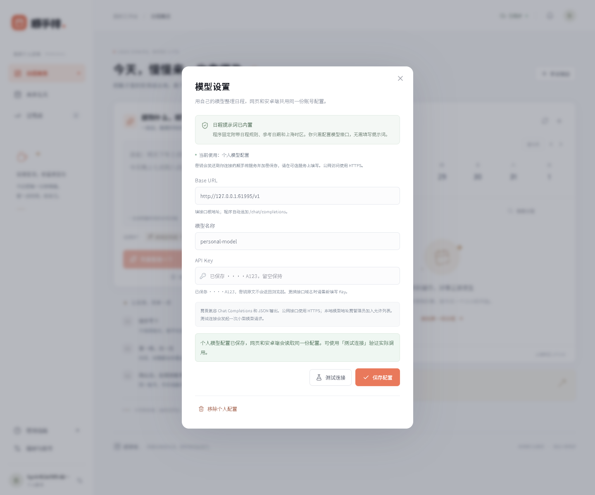

# 每个账号接入自己的模型

从 v1.2.0 起，网页和 Android 客户端共用“模型设置”。用户可以填写自己的模型接口与 API Key，无需修改环境变量，也无需填写日程提示词。同一服务、同一账号读取同一份配置；其他账号无法查看或使用这份个人配置。

## 用户操作

1. 登录顺手排，打开“偏好与账号”或右上角账号入口，点击“模型设置”。
2. 填写 **Base URL**、**模型名称**、**API Key**。Base URL 是服务商提供的接口根地址，例如 `https://api.example.com/v1`；程序自动追加 `/chat/completions`。
3. 点击“测试连接”。它会向所填模型发送一条固定的小型 JSON 测试请求，可能消耗服务商额度；测试成功不会自动保存配置。
4. 点击“保存配置”。之后的日程整理优先使用该账号的个人模型。
5. 在另一台设备登录同一服务和账号，打开“模型设置”，可以看到同步后的接口、模型名称和密钥掩码。



接口需要兼容 Chat Completions，并支持 JSON 输出。模型名称必须填写账号实际可用的模型 ID。不同服务商支持的参数和型号不同；界面保存成功表示配置已持久化，实际连通性需要通过“测试连接”或一次成功的日程整理验证。

已有 Key 时，输入框留空会保留同一接口来源的密钥，只修改模型名不必重新输入。更换接口域名或端口后，需要重新填写 Key，避免把原服务的密钥发送给另一个地址。密钥原文不会回显，返回页面的只有掩码。

“移除个人配置”需要再次确认。移除后使用服务端默认模型；管理员没有配置默认模型时，回到明确标记的规则解析。删除个人模型配置不会删除账号或日程。

## 提示词固定在哪里

日程整理的系统提示词固定在服务端 `src/lib/parser.ts`，程序会附带参考日期、上海时区和输出格式。模型设置不提供提示词、系统消息或 SQL 编辑入口，接口也拒绝这些额外字段。

模型只返回草稿，仍要经过日期、时长和结构校验；用户确认后才保存正式日程。配置自己的模型不会绕过账号隔离、保存确认、防重或时间冲突检查。

网页和 Android 使用同一套服务端提示词和业务接口。应用中的模型设置界面也与网页一致；Android 首页的“服务地址”用于连接顺手排服务，模型设置中的 Base URL 则用于指定由该服务调用的模型接口。

## 手机扫码连接电脑服务

电脑网页点击“手机连接”，选择手机可访问的电脑局域网 IP 或公网 HTTPS 地址；二维码会随地址更新。安卓首页点击“扫码连接”，授权相机后扫描二维码，即可使用扫码得到的服务根地址连接。也可以继续手工输入地址。

二维码只包含服务地址，不包含账号会话或模型 Key。扫码后登录自己的账号，才能读取自己的日程和模型配置。手机、电脑需要能够访问同一个服务；本地演示时连接同一 Wi-Fi，电脑保持服务运行。网页会拒绝为 `localhost` 等指向手机自身的地址生成二维码。

## 密钥怎样保存

个人 API Key 会发送到用户当前连接的顺手排服务，并使用 AES-256-GCM 加密保存。账号 ID 参与认证加密校验，另一账号不能直接复用复制来的密文。读取配置的 HTTP 接口只返回掩码和配置元数据，不返回原始 Key 或密文；页面不会把 Key 写入 localStorage/sessionStorage。

这属于服务端加密存储，服务运行时仍需要解密以调用模型。请只向自己信任的顺手排服务填写 Key；公网访问应使用 HTTPS。APK 不打包用户 API Key；模型请求由服务端发出，固定提示词也由服务端添加。

本地 SQLite 模式首次保存时，会在数据库同目录生成 `model-encryption.key`。默认位置是 `data/model-encryption.key`，文件已加入数据目录的 Git 忽略范围，并限制本机文件权限。备份或迁移时需要同时保留数据库和这个密钥文件；丢失加密密钥后需要恢复备份或由用户重新填写 Key。

Supabase 模式和多个后端实例应由管理员设置相同的 `MODEL_SETTINGS_ENCRYPTION_KEY`。它是 **32 字节随机值的 Base64**，例如在可信终端生成后放入部署平台的私有环境变量：

```sh
node -e "console.log(require('node:crypto').randomBytes(32).toString('base64'))"
```

不要把输出提交到仓库或粘贴到公开日志。同一数据库的不同后端实例必须使用同一加密密钥；不要随意替换现有密钥。

## Supabase 升级

新部署按文件名顺序执行 `supabase/migrations/` 内全部迁移。已有 v1.1.0 数据库只需追加执行：

```text
supabase/migrations/20261027010000_model_settings.sql
```

迁移创建 `model_settings` 表及受控 RPC；不修改已有日程数据。按当前认证身份读取和更新记录，浏览器没有直接表读写权限；数据库中的 Key 始终是密文。

模型设置使用版本号防止两端互相覆盖。另一端已更新时，旧版本保存会收到冲突；界面提示重新加载后再确认。删除保留不含密钥的版本标记，避免旧页面重新写回已移除的配置。

## 接入本地或局域网模型

默认只允许解析为公网地址的 HTTPS 模型接口，拒绝元数据地址、环回/私有地址、重定向和内嵌账号密码的 URL。这样可以避免用户自定义接口被用于访问后端内网。

确实需要连接管理员控制的本地模型时，由管理员显式配置允许的主机名或 IP：

```dotenv
AI_ALLOWED_PRIVATE_HOSTS=localhost,127.0.0.1
```

重新启动后端后，用户才能填写例如 `http://127.0.0.1:11434/v1`。允许列表只填写主机，不带协议和端口；仅加入自己信任的模型服务。这里的 `127.0.0.1` 指运行顺手排后端的机器，而不是使用网页或 APK 的手机。

## 验证范围

自动化覆盖配置隔离、AES-GCM 认证加密、密钥脱敏、空 Key 复用、版本冲突、删除重试与数据库权限；浏览器测试使用受控模型接口验证测试连接、个人模型调用和固定提示词。模型服务错误不会把上游原文或 Key 反射回界面。

二维码测试覆盖网页地址校验、二维码生成及安卓扫描结果的校验/连接路径；模拟器中的直接结果测试不等同于实体手机相机识别验证。

测试不会调用付费模型或使用真实个人 API Key。真实服务商的型号、额度、网络和输出效果仍应由用户使用自己的账号验证。运行记录见 [验收记录](acceptance.md)及对应 GitHub Actions。
