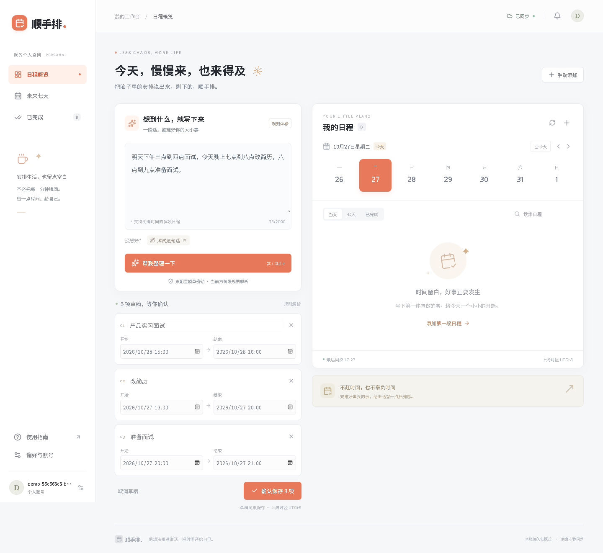
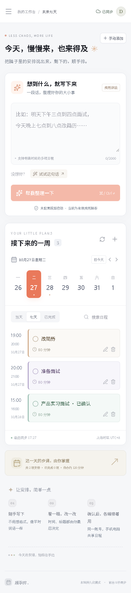

# 不想一条条填日历，我做了个能整理日程的小工具

准备面试时，待办很容易写成一长串：“今天改简历，明天下午面试，晚上再准备一下。”真正打开日历，却还要反复点日期、填标题、选起止时间。顺手排把这段重复工作缩短成三个动作：写下来、看一眼、确认保存。

## 先看看它能做什么

在左边写一段安排，右边查看保存后的日程。每条草稿都显示具体日期与起止时间，可以修改标题、调整时间，或者直接取消。你点确认之前，它不会进入正式日程。保存后可以标记完成、重新编辑或删除，也能切换当天和未来七天。

它还支持同一账号在不同浏览器继续使用。数据放在共同的服务端，手机和电脑各自读取，所以关掉一个页面不会把日程带走。当前提供前台刷新和站内提醒，暂时不做锁屏提醒、循环日程或自动找空档。

## 不买服务，也能先跑起来

准备 Node.js 24 或以上版本，从 [GitHub 仓库](https://github.com/G-E-E-D/shunshoupai) 下载源码，进入目录执行 `npm ci`，再执行 `npm run dev`。浏览器打开 `http://localhost:3000` 就能看到页面。

首次使用点击登录入口，切换到“注册账号”，填写邮箱和至少八位密码。本地模式中邮箱只是账号标识，不会收到验证邮件；每个人应注册自己的账号。账号、日程和保存记录会存进服务端 SQLite 文件，重启服务后仍然存在。不要把这个文件和密码传到公开仓库。

没有模型密钥时，页面会明示“规则体验”。这个模式使用有限中文规则，适合先验证操作流程，不能当作真实模型演示。想接模型，再将环境变量示例复制为 `.env.local`，填写服务端模型密钥、地址和可用型号，重新启动即可；详细配置在仓库的云端说明里。

## 从一句话到三项草稿

可以点击“试试这句话”，或手动输入：

> 明天下午三点到四点面试，今天晚上七点到八点改简历，八点到九点准备面试。

点击“帮我整理一下”后，应用会生成三张卡片：明天的面试、今天的简历修改和面试准备。检查这里显示的具体年月日，不要只看“明天”两个字。如果面试改到四点，可以直接修改草稿的开始、结束时间，然后确认保存。

没有明确结束时间时，应用会显示默认时长等假设，等你确认；输入“周五三点面试”，它会要求补充上午还是下午。输入“每周一”或“全天”也会说明当前限制，而不是去掉这些词继续保存。这些停下来确认的细节，比一味返回漂亮答案更有用。

## 换个屏幕，接着用

手机、电脑连接同一局域网后，先停止开发服务，执行 `npm run build`、`npm run start`，用生产服务避开开发热更新的来源限制。再用 `ipconfig` 找到电脑的 IPv4 地址，让两端打开同一个地址，例如 `http://192.168.1.20:3000`，登录刚才的账号。防火墙需要允许可信网络访问。HTTP 演示保持默认的 `COOKIE_SECURE=false`，并留空 `APP_ORIGIN`。

在一个页面保存后，另一个前台页面大约八秒内会刷新；切回页面、恢复联网和点击刷新也会重新查询。页面显示最后同步时间，断网会显示错误。这里的图片来自真实运行页面的浏览器截图，手机图片是手机宽度视口，不能替代真实手机蜂窝网络验收。

## 开发中真正花时间的地方

我用 Codex 辅助实现和测试这个项目。最需要反复检查的并不是输入框，而是“明天”在上海午夜之后究竟是哪天，以及重复点击保存会不会多出一份安排。为此，解析以服务端参考时间计算日期，保存使用固定请求编号；同一请求重试会返回原结果。

两端同时改同一条日程时，较旧版本会被拒绝，让用户刷新后重新确认。批量保存也会在事务里检查时间冲突；只要其中一项冲突，整批都不会悄悄保存一半。相关情况已经写进自动化测试，实际记录可以在验收文档查看。

## 现在适合怎样使用

顺手排目前适合个人的上海时区单次安排：求职准备、学习计划和生活小事。想做公网跨设备体验，可以按文档接入 Supabase；没有外部账号时，共用一个本地服务也能验证真实持久化与同步。

作品已经提供源码、启动步骤、数据库脚本和图文教程。真实模型联调、公网部署及真实手机网络测试仍需要你自己的账号与环境；后续再根据使用反馈决定是否补自动排期、可靠提醒和外部日历连接。先把一句话变成一份真正能保存、能修改的安排，这就是这个版本的目标。
